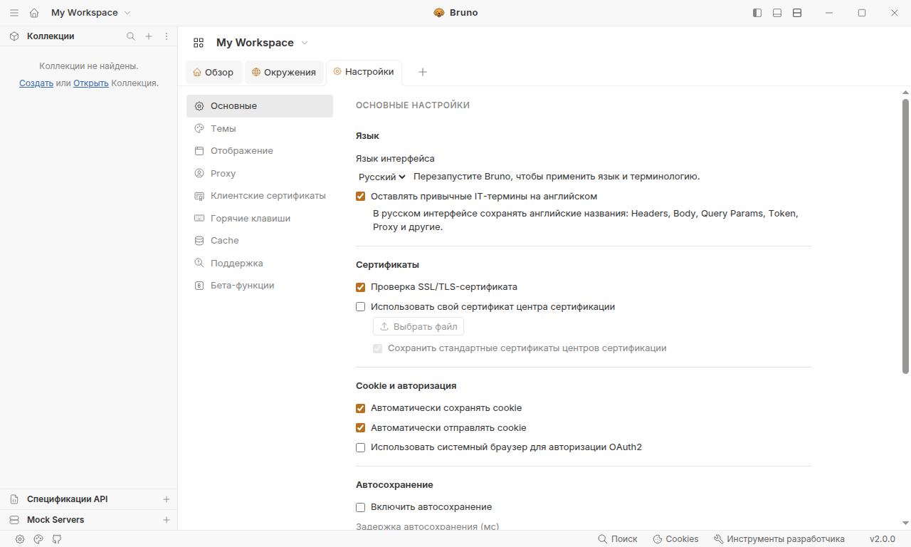

<div align="center">


# Bruno

**API-клиент с русским интерфейсом, без ИИ и рекламы платных функций.**

[](https://github.com/ArtimTikhonov/bruno-clean/actions/workflows/clean-build.yml)
[](https://github.com/ArtimTikhonov/bruno-clean/releases/latest)
[](license.md)

[Скачать](https://github.com/ArtimTikhonov/bruno-clean/releases/latest) · [История изменений](CHANGELOG.md) · [Сообщить об ошибке](https://github.com/ArtimTikhonov/bruno-clean/issues/new/choose) · [English](README.en.md)

</div>

Неофициальный форк [usebruno/bruno](https://github.com/usebruno/bruno), который поддерживает
[ArtimTikhonov](https://github.com/ArtimTikhonov). Приложение называется **Bruno**;
`bruno-clean` остаётся именем репозитория и внутренним идентификатором для сохранения настроек.
Форк не связан с Bruno Software Inc. и не является официальной сборкой Bruno.

## Что изменено

| Возможность | В этом форке |
| --- | --- |
| Язык интерфейса | Русский по умолчанию; можно выбрать English |
| IT-терминология | Отдельная настройка английских названий Headers, Body, Query Params, Token, Proxy, Cache и других |
| ИИ | Удалены чат, генерация, ИИ-автодополнение, IPC-обработчики и SDK провайдеров |
| Реклама | Удалены продвижение Golden Edition и удалённая лента объявлений Bruno |
| Данные запросов | Содержимое запросов и ответов, код, URL и имена переменных не переводятся |
| Название приложения | Bruno; исполняемые файлы `bruno.exe` и `bruno` |
| Сборки | Установщик Windows x64 и AppImage Linux x64 |

Сохраняются возможности открытой кодовой базы: HTTP/REST, GraphQL, gRPC и WebSocket,
коллекции, окружения, скрипты, тесты, импорт и экспорт, работа с Git и OpenAPI.
Подробности — в [CHANGELOG](CHANGELOG.md).

## Скачать и установить

Готовые файлы находятся в [последнем релизе](https://github.com/ArtimTikhonov/bruno-clean/releases/latest).
Начиная с **2.1.0**, номер в имени файла совпадает с версией приложения и Git-тегом `vX.Y.Z`.

| Система | Файл | Установка |
| --- | --- | --- |
| Windows x64 | `bruno_X.Y.Z_x64_setup.exe` | Запустите установщик; приложение появится в меню «Пуск» как Bruno |
| Linux x64 | `bruno_X.Y.Z_x86_64_linux.AppImage` | Разрешите выполнение файла и запустите его |

```bash
chmod +x bruno_2.1.0_x86_64_linux.AppImage
./bruno_2.1.0_x86_64_linux.AppImage
```

Каждый релиз содержит `SHA256SUMS.txt`. Проверка в Linux:
`sha256sum --ignore-missing -c SHA256SUMS.txt`. В Windows:
`Get-FileHash .\bruno_2.1.0_x64_setup.exe -Algorithm SHA256` — сравните результат с файлом сумм.
Windows-сборки не имеют цифровой подписи. Сборки macOS и ARM64 в релизы этого форка пока не входят.

Если окно не отображается в Wayland или виртуальной машине, попробуйте
`./bruno_2.1.0_x86_64_linux.AppImage --ozone-platform=x11 --disable-gpu`.
Другие способы запуска описаны в [инструкции по сборке](docs/fork/building.md).

## Язык и английские IT-термины

Откройте **Настройки → Основные → Язык**.

- **Язык интерфейса** — Русский или English.
- **Оставлять привычные IT-термины на английском** — сохраняет названия вроде Headers,
  Body, Query Params, Token, Proxy и Cache в русском интерфейсе. По умолчанию выключено.

После изменения языка или терминологии перезапустите приложение.
Настройка терминов использует подготовленный словарь названий и не переводит пользовательские данные.



## Платные функции и ограничения

Форк собирается из открытых исходников. Он не загружает и не разблокирует закрытые коммерческие модули
и не обещает полный набор возможностей Pro или Ultimate.

В проверенных обработчиках создания рабочих пространств и OpenAPI Sync нет тарифных лимитов
«2 пространства» и «5 синхронизаций в месяц». Это вывод о данной кодовой базе,
а не гарантия отсутствия всех технических ограничений. Снятие защитных лимитов размера,
времени выполнения или сетевых запросов не является целью проекта.

## Разработка

Нужны Git и версия Node.js из [.nvmrc](.nvmrc). Репозиторий использует npm workspaces.

```bash
git clone https://github.com/ArtimTikhonov/bruno-clean.git
cd bruno-clean
npm run setup
npm run dev
```

`setup` переустанавливает зависимости и собирает общие пакеты. Для воспроизводимой установки
и упаковки используйте [building.md](docs/fork/building.md).

- [Участие в разработке](contributing.md)
- [Правила версионирования и выпуск релиза](docs/fork/versioning.md)
- [История изменений](CHANGELOG.md)
- [Лицензии и авторство](THIRD_PARTY_NOTICES.md)

## Проверки и релизы

[GitHub Actions](https://github.com/ArtimTikhonov/bruno-clean/actions/workflows/clean-build.yml)
проверяет согласованность версий, изоляцию объявлений, переводы и сохранность значений,
JavaScript, сборку и запуск приложения. На обеих платформах проверяются русский интерфейс,
сохранение режима английских IT-терминов и переключение на English.
На Windows дополнительно проверяются установка и запуск установленного приложения.

Коммиты в `main` запускают проверки и сохраняют сборки как артефакты на 30 дней.
Публичный релиз создаётся по тегу `vX.Y.Z` только после успешных проверок обеих платформ.
Старые теги `clean-build-N` оставлены как история предварительных сборок.

## Авторство и лицензия

Оригинальный Bruno: Anoop M D, Anusree P S и Contributors.
Исходный код распространяется по [MIT](license.md); уведомления об авторских правах сохранены.
Bruno — товарный знак Anoop M D.

Сохранённая иллюстрация собаки — [OpenMoji](https://openmoji.org/),
[CC BY-SA 4.0](https://creativecommons.org/licenses/by-sa/4.0/).
Полные сведения — в [THIRD_PARTY_NOTICES.md](THIRD_PARTY_NOTICES.md).
Документация оригинального проекта: [docs.usebruno.com](https://docs.usebruno.com/).
